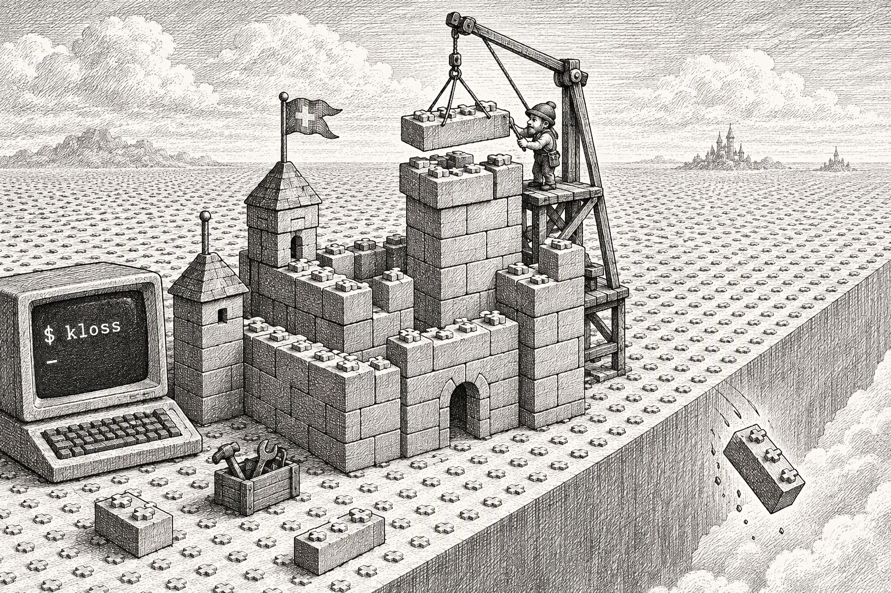

<p align="center"></p>

<p align="center">
<a href="https://github.com/mklab-se/kloss/actions/workflows/ci.yml"></a>
<a href="https://www.npmjs.com/package/@mklab-se/kloss"></a>
<a href="https://github.com/mklab-se/kloss/releases/latest"></a>
<a href="https://github.com/mklab-se/homebrew-tap/blob/main/Formula/kloss.rb"></a>
<a href="https://github.com/mklab-se/kloss/blob/main/LICENSE"></a>
</p>

<!-- "What's new" callout: keep it right after the badges and refresh it on every minor/major
     release (version and a one-line summary of the headline changes). Only link CHANGELOG.md. -->
<p align="center">
  <strong>kloss 0.3</strong> is here: build together in shared sessions, log in with your own
  e-mail address, let your AI agent build for you over MCP, and get a picture or a slimmer
  version of any model in one call.<br>
  <a href="CHANGELOG.md"><strong>What's new</strong></a>
</p>

# kloss

**kloss** (Swedish for "building block") lets you build, visualize and optimize models made of
virtual bricks, klossar, on an endless floor. Describe a model one kloss at a time, from a
terminal, a script or your AI agent, and watch it come together live in 3D in your browser:
every kloss falls from the sky and lands exactly where the rules say it must.

- **Build** by hand with simple REST calls, or just ask your agent: "build a small red house".
- **Visualize** the model live in 3D (everyone in the session sees each kloss land), or get a
  picture of it from any side.
- **Optimize** a model into fewer, bigger klossar without changing how it looks or stands.
- **Keep** models as plain `.kl` text files: easy to read, write, share and put in git.

## Getting started

You need the address of a kloss server (your host gives it to you, or
[run your own](#run-your-own-kloss)) and, when login is on, the password. You log in with your
own e-mail address: it is how others in a session see who dropped what. There is no sign-up.

Open the address in a browser, log in, and start a session. A session is one model, with a short
code like `otter-maple-42`; share the code and others can build in it with you or watch.

### From a terminal

```sh
KLOSS=https://your-kloss.example        # the address you were given

# log in once: any e-mail address and the password you were given
TOKEN=$(curl -s -X POST $KLOSS/api/token -H 'content-type: application/json' \
  -d '{"email":"ada@example.com","password":"..."}' | jq -r .access_token)
AUTH="Authorization: Bearer $TOKEN"

curl -X POST $KLOSS/api/sessions -H "$AUTH"
# {"code":"otter-maple-42","url":"https://your-kloss.example/s/otter-maple-42","klossar":0}
```

Open the `url` in a browser, then drop klossar and watch them land:

```sh
S=$KLOSS/api/sessions/otter-maple-42
curl -X POST $S/klossar -H "$AUTH" -d '0,0|2x2|red'     # a red 2x2
curl -X POST $S/klossar -H "$AUTH" -d '.'               # the same again, on top
curl -X POST $S/klossar -H "$AUTH" -d '2,0|2x4|blue'    # a blue 2x4 beside it
curl -X DELETE $S/klossar/last -H "$AUTH"               # changed your mind: poof, gone
```

The server documents its whole API at **`/docs`**, with a "try it" button for every call, and as
OpenAPI at `/openapi.json` (handy for your own tools and agents).

### With your AI agent

kloss is also an MCP server, so an agent such as Claude Code can build for you without knowing
the API. When the server has MCP turned on, add it:

```sh
claude mcp add --transport http kloss https://your-kloss.example/mcp
```

The first time it is used, the agent opens kloss's login page in your browser; log in as above
and the agent takes it from there. Then just talk to it:

- "Visualize castle.kl" (it asks whether you want the live 3D view or a picture)
- "Open car.kl" (you get a link to the live view)
- "Add a blue 2x4 at 1,0", then "Undo that"
- "Build a small house with a red roof"
- "Optimize the open model"
- "Save the model to house.kl"

The agent gets tools to start sessions, drop and take back klossar, look at a picture of the
model, optimize it, and read or replace the whole model. Every call is made as you, with your
e-mail address, just like your own REST calls.

## The .kl format

A model is a plain text file, read from the top down. Each line drops one kloss from infinitely
high, and it stops at the first thing it touches: the floor or another kloss. One plupp (the
plus-shaped bump on top of a kloss) of overlap is enough to hold. You never write a height; it
comes from where the kloss lands.

A line is `x,y|size|color`. Leave out the size or the color and the last one is used again; a
line with just `.` drops the same kloss again, right on top:

```text
# a gray base, a tower on it, and the start of a wall
  1,  1 | 4x2 | gray
  1,  1 | 2x2
  5,  1
.
  1,  3 | 2x4 | red
```

The second line drops a gray 2x2, the third a gray 2x2 at 5,1, and the dot another one on top of
it. A color alone keeps the size (`5,1|blue`). Spaces around `,` and `|` are fine.

- **Size** `<w>x<d>`: `w` pluppar along x, `d` along y: `1x1`, `1x2`, `2x1`, `1x4`, `4x1`,
  `2x2`, `2x4`, `4x2` (a `4x2` is a `2x4` turned).
- **Color**: white, gray, black, red, orange, yellow, lime, green, blue, azure, purple, pink,
  brown, tan.
- **Position** `x,y`: the corner with the smallest coordinates, whole numbers from -10000 to
  10000.
- `#` starts a comment. A model holds at most 10000 klossar.

Start a session from a file, and download a model to keep it:

```sh
curl -X POST $KLOSS/api/sessions -H "$AUTH" --data-binary @castle.kl
curl $S/model.kl -H "$AUTH" > tower.kl
```

[`examples/castle.kl`](examples/castle.kl) is a castle of over 2,000 klossar to try: corner
towers, walls you can walk on, a gatehouse and a great hall set for a feast.

## The REST API

All under `/api/sessions/<code>` (see `/docs` for every detail):

| Request | Does |
| --- | --- |
| `POST /api/sessions` | Starts a session, optionally from a `.kl` body. Returns `{ code, url }`. |
| `POST …/klossar` | Drops one kloss: a line (`2,0\|2x4\|blue`, `5,1`, `.`) or JSON (`{"size":"2x4","color":"blue","x":2,"y":0}`). Returns where it landed (`level`). |
| `DELETE …/klossar/last` | Takes back your most recent kloss (it vanishes with a poof for everyone watching). |
| `GET …/render.png` | A picture of the model: `?view=iso` (default), `top`, `front` or `side`, and `size` (64 to 2048 pixels). |
| `POST …/optimize` | Merges klossar of the same color side by side on the same level into bigger ones, where the model looks and stands exactly the same. Everyone watching sees it happen: the extra klossar go up in smoke and the ones that stay grow into their place. `?preview=true` only tells you how many it would save. |
| `GET …/model` | The model as JSON, with where each kloss landed and who dropped it. |
| `GET …/model.kl` | The model as `.kl` text: how you save it. |
| `PUT …/model` | Replaces the model with a `.kl` body; nothing changes if any line is invalid. |
| `GET …/events` | Live updates as Server-Sent Events. |
| `DELETE /api/sessions/<code>` | Removes the session for everyone. |
| `GET /healthz` | Public: which kloss version you reach, and whether login is on. |

Errors come back as `{ "error": "..." }` (with `"line"` when a model line is wrong). Sessions
live in the server's memory: one nobody has touched or watched for a couple of hours is removed,
so download what you want to keep.

## The 3D view

Built for a Mac trackpad, and fine with a mouse:

| Gesture | Does |
| --- | --- |
| Two-finger swipe | Pans |
| Pinch | Zooms toward the pointer |
| Click and drag | Rotates around the model |
| Shift + two-finger swipe | Rotates (as in Fusion 360) |
| Shift + drag | Pans |
| Double-click | Rotate around that point from now on |
| WASD / arrows | Move along the floor (as in Cities: Skylines II) |
| Q / E | Rotate left / right |
| + / - | Zoom in / out |
| F or F6 | Fit the whole model and turn auto-fit back on |
| Home | Back to the starting view |
| ? | Show the controls |

The view keeps the whole model in sight (auto-fit) until you move the camera yourself. The
compass on the floor in the corner shows which way X (red) and Y (green) run; click it to go
back to the start view. With a mouse, the wheel zooms and right-drag pans.

## Run your own kloss

Install it (Homebrew, npm or a single binary, see [INSTALL.md](INSTALL.md)) and start it:

```sh
brew install mklab-se/tap/kloss
kloss serve --open
```

It serves http://127.0.0.1:4321 with login off, so the examples above work without the token.
Set `KLOSS_PASSWORD=...` to turn login on, `--mcp` to turn the MCP endpoint on, and
`--host 0.0.0.0` to let others on your network in. `kloss serve --help` lists the rest.

## More

- [CHANGELOG.md](CHANGELOG.md): what changed in each version.
- [docs/TRAINER.md](docs/TRAINER.md): running a class with kloss.
- [docs/DEVELOPMENT.md](docs/DEVELOPMENT.md): building, testing and releasing kloss.

## License

[MIT](LICENSE) © Kristofer Liljeblad
